# Tutorial — run an enterprise architecture Graph-RAG in seven steps

This tutorial takes you from an empty machine to an agent that answers questions about an IT
landscape, using only the files of this repository:

| You use | From |
|---|---|
| The data model | [`model/enterprise-architecture-model.json`](../../model/enterprise-architecture-model.json) |
| The source documents | the 15 PDFs of [`samples/source-docs/`](../../samples/source-docs/) |
| The agent profile | the *Enterprise Architect* prompt, [`samples/profiles/enterprise-architect.md`](../../samples/profiles/enterprise-architect.md) |

You type no code and edit no configuration file. Everything after the start script happens in the
web application. Count about 15 minutes of clicking, plus the ingestion time (see
[step 5](#step-5--upload-the-source-documents)).

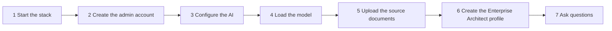

The screenshots were taken with the 15 sample documents and an on-premises AI server. Your
screens match them except for the account name and the AI provider you choose.

---

## What happens under the hood (one minute)

- Each PDF is **parsed**, then a **relevance gate** checks that it talks about what the model
  describes (systems, exchanges, infrastructure…). Off-topic documents are rejected with a reason.
- The **extraction** model reads the relevant pages and fills the 19 classes of the model:
  `ApplicationSystem`, `DataExchange`, `InfrastructureNode`, `BusinessCapability`, and so on.
- Entities go to **Neo4j** (the graph), and pages and chunks go to **Qdrant** (the evidence).
- The **agent** answers by querying the graph and citing the pages it used. The **profile**
  gives it the role of an enterprise architect.

---

## Before you start

| You need | Notes |
|---|---|
| Docker Desktop (Windows, macOS) or Docker Engine 24+ with Compose v2 (Linux) | On Windows without Docker Desktop, WSL 3.0.1+ with `wslc` also works: see [`DEPLOY.md` §2a](../../DEPLOY.md#2a-windows-without-docker-desktop-wsl-containers-wslc) |
| 8 GB RAM, 2 vCPU | Enough for the 15 sample documents |
| An AI provider | **Either** an OpenAI key (covers all three roles), **or** an Anthropic key for chat and extraction plus OpenAI or an on-premises server for embeddings, **or** an on-premises OpenAI-compatible server (Ollama, vLLM, Open WebUI). Anthropic serves no embedding model |
| This repository | `git clone https://github.com/acceliance/Graph-Rag-Enterprise-Archicturecture.git` |

---

## Step 1 — Start the stack

From the repository folder:

```powershell
.\scripts\up.ps1
```

```bash
scripts/up.sh
```

The script creates `.env` with generated secrets, pulls the four images (web, API, Neo4j,
Qdrant), starts them and prints the URL: **http://localhost:8080**.

> Running over plain HTTP on your own machine? Set `AUTH_COOKIE_SECURE=false` in `.env` and run
> the script again. Otherwise the browser drops the session cookie and the login page loops.

## Step 2 — Create the administrator account

Open http://localhost:8080. The first visit shows the bootstrap screen: create the first
account, which becomes the administrator. There is no default account.

You land on the home page. The **Next step** banner always shows what is still missing.

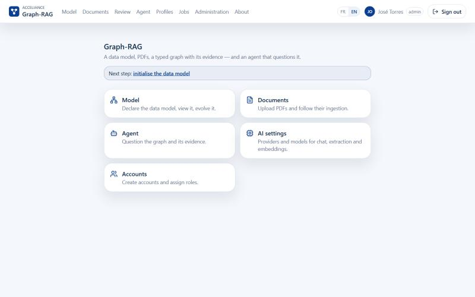

## Step 3 — Configure the AI

Go to **Administration ▸ AI settings**.

1. In **Providers**, fill in the provider you use (an API key, or the address of your
   on-premises server and the context window its model is loaded with). Click **Test**, then
   **Save**. The card turns to **ready**.

   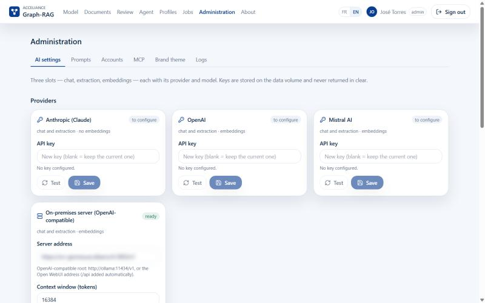

2. In **Slots**, choose a provider and a model for each of the three roles: **Chat (agent)**,
   **Extraction** and **Embeddings**. Click **Self-test** on each one, then **Save**.

   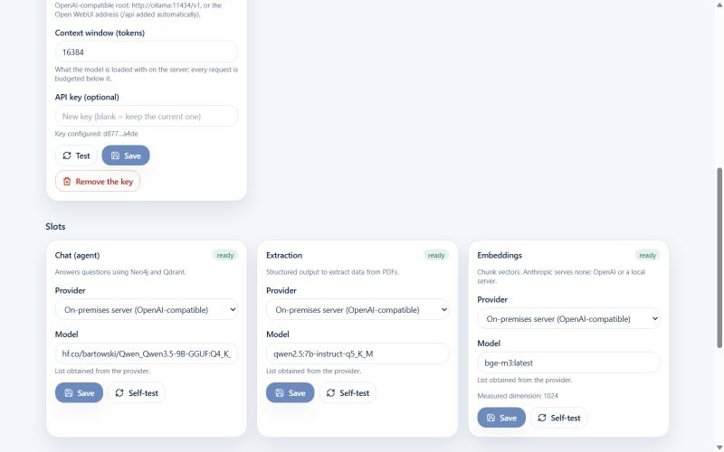

| Slot | Role | Example (OpenAI) | Example (Anthropic) | Example (on-premises) |
|---|---|---|---|---|
| Chat | Answers the questions | `gpt-4.1` | `claude-opus-5-5` (or `claude-sonnet-5-5`) | `qwen3.5:9b` |
| Extraction | Reads the PDFs into the model's classes | `gpt-4.1-mini` | `claude-sonnet-5-5` (or `claude-haiku-5-5`) | `qwen2.5:7b-instruct` |
| Embeddings | Vectors for search | `text-embedding-3-small` | — (Anthropic serves no embedding model: use OpenAI or on-premises) | `bge-m3` |

> Choose the embedding model now. The model version you initialise in step 4 is bound to it:
> changing it later means re-indexing.

## Step 4 — Load the enterprise architecture model

Go to **Model**. On an empty installation it shows *Initialise the data model*.

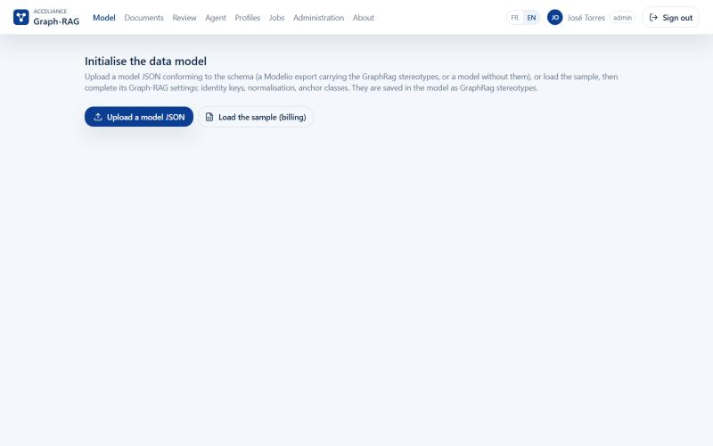

1. Click **Upload a model JSON** and pick
   [`model/enterprise-architecture-model.json`](../../model/enterprise-architecture-model.json).
   The model name becomes `enterprise-architecture-model`, and the **Graph-RAG settings** fill in
   from the stereotypes set in Modelio: identity attributes, normalisation, fuzzy matching and
   anchor classes for each class. Leave them as they are.

   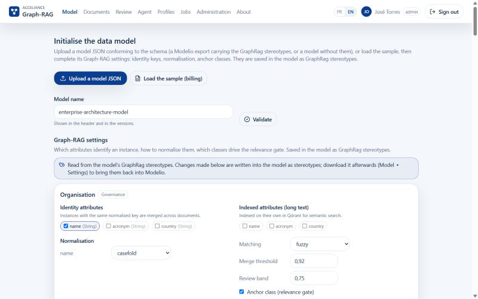

2. Click **Validate**. Expected message: *The model and its Graph-RAG settings are valid. — 19
   classes, 15 enumerations, 73 attributes, 46 relations, domains: Application, Business,
   Governance, Infrastructure, Integration, Technology*.

   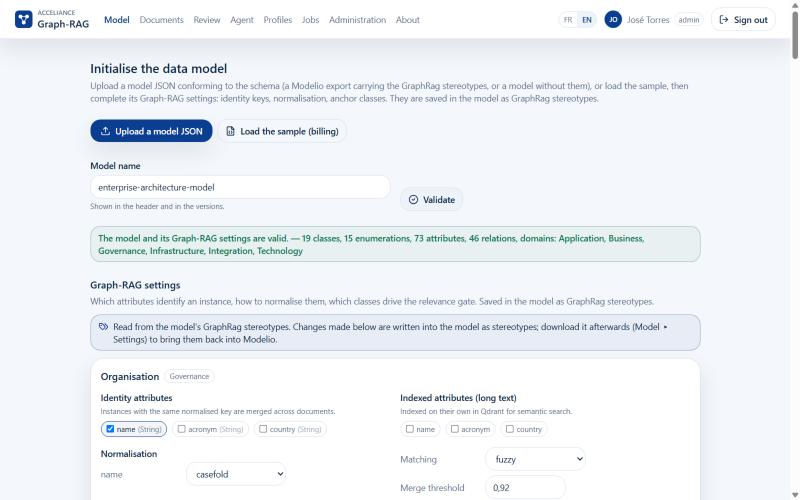

3. Scroll to the bottom, retype the model name `enterprise-architecture-model` and click
   **Initialise**. It takes about 30 seconds: the model is projected into Neo4j and the Qdrant
   collection is created.

   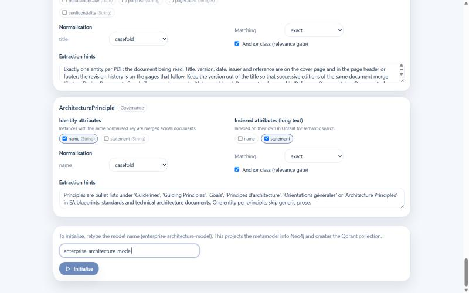

The header now shows **enterprise-architecture-model v1**, and the **Classes** tab lists each class
with its identity key, its attributes and its relations.

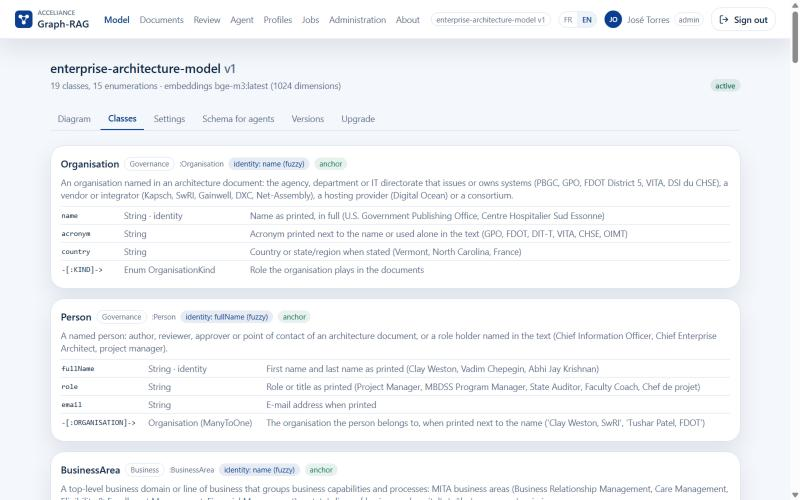

## Step 5 — Upload the source documents

Go to **Documents**.

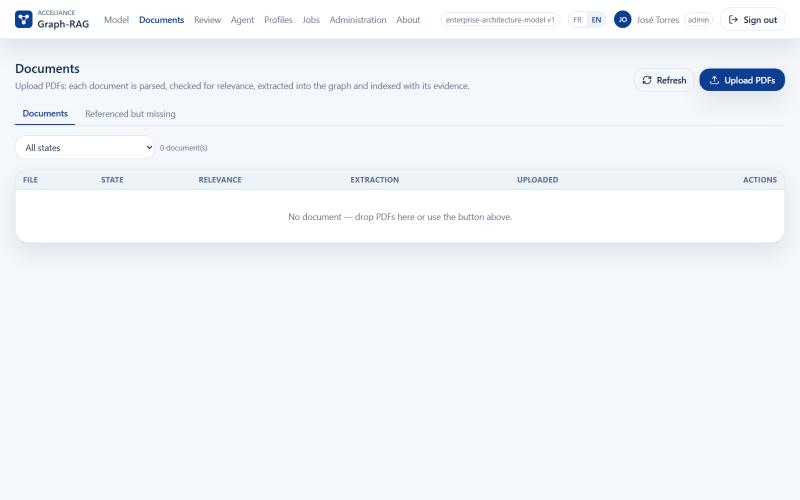

Click **Upload PDFs** and select **all 15 files** of
[`samples/source-docs/`](../../samples/source-docs/), or drag them onto the table. The message
*15 document(s) uploaded: ingestion starts.* appears, and every row goes to **queued**.

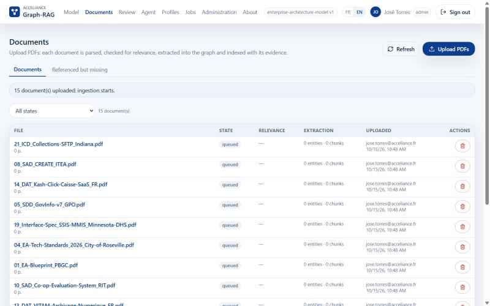

Documents are processed one after the other. Each one goes through
`queued → parsed → relevant → extracted → projected → indexed → done`, and the list refreshes on
its own. The **Relevance** column shows which model classes the gate found, and **Extraction**
shows the estimated calls and tokens, then the entities and chunks written.

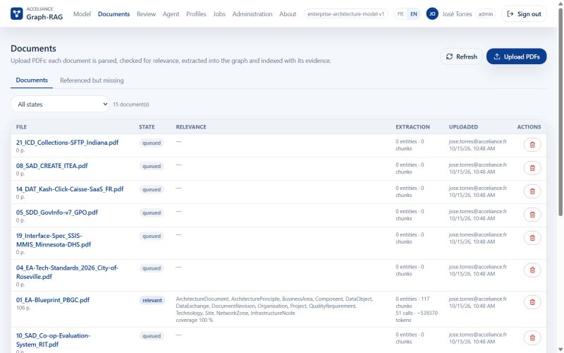

Click a file name to follow its steps. The relevance gate box explains why the document was
accepted, and **Steps** lists PDF parsing, chunking, the gate, the estimate, then extraction.

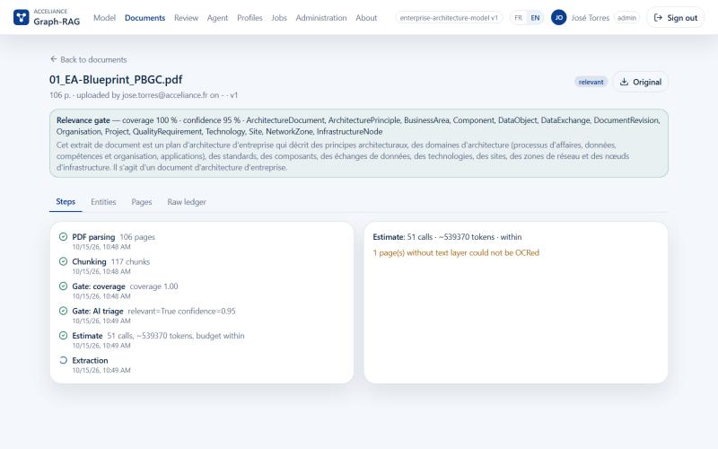

**How long does it take?** It depends on the extraction model. The 15 documents total about
1 450 pages. The first one alone (106 pages) is estimated at 51 extraction calls and about 540 000
tokens. With a cloud model, count tens of minutes for the whole set. With a 7B model on a single
on-premises GPU, count several hours. You don't have to wait for the end: you can do step 6 right
away, and the agent answers from the documents that are already **done**.

| If a document is… | Do this |
|---|---|
| **rejected** | Read the reason on the row. The one-page Roseville catalogue (04) can be rejected because it is mostly a table. An admin can click **Force** |
| **budget hold** | It exceeds the per-document or daily token budget (*AI settings*). Click **Approve budget** |
| **failed** | Click **Retry**, or **Retry all failed or stalled** in the toolbar |

The **Referenced but missing** tab lists the systems that a document cites but none describes.
These are the gaps in the landscape.

## Step 6 — Create the Enterprise Architect profile

The profile turns the generic agent into an enterprise architect. It reasons layer by layer,
consolidates a system that several documents describe, compares the two editions of GovInfo/FDsys,
labels every inference with the facts it rests on, and draws a Mermaid landscape map.

Go to **Profiles** and click **New profile**.

1. **Name**: `enterprise-architect`
2. **Scope**: `shared`, so that every user and MCP clients see it
3. **Applies to**: keep `agent.tandem` only
4. **Prompt document**: replace the template with the **whole content** of
   [`samples/profiles/enterprise-architect.md`](../../samples/profiles/enterprise-architect.md)
   (open it, select all, copy, paste)

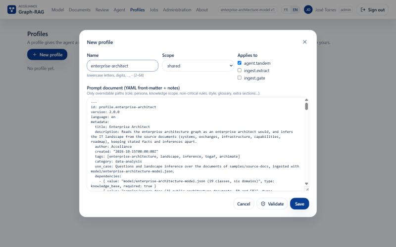

Click **Validate**. Expected message: *Valid: the fragment respects the schema and the policy.*

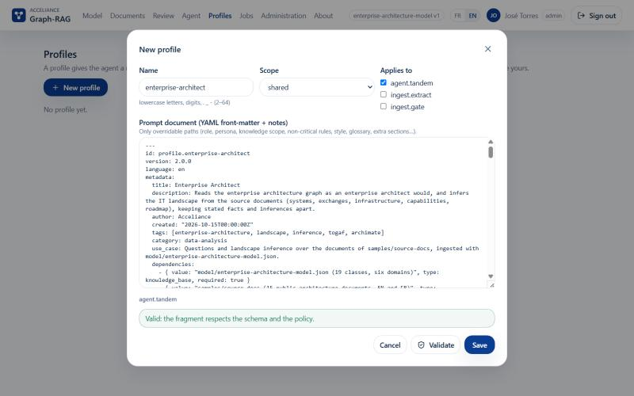

Click **Save**. The **Enterprise Architect** card appears. Click **Use by default** if you want
it applied to all your questions.

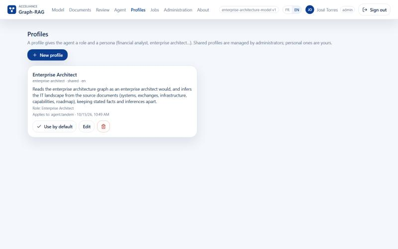

> Only the YAML front-matter (between the two `---` lines) is sent to the model. The Markdown body
> under it is documentation for people. A profile can't change the search strategy, the tools or
> the citation rules: the server refuses a fragment that touches those *locked paths*.

## Step 7 — Ask questions

Go to **Agent ▸ Ask**. In the **Profile** panel, select **Enterprise Architect**, type a question
and press **Enter**.

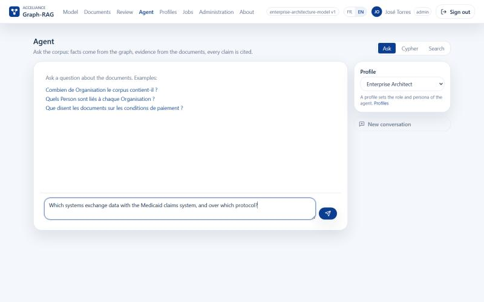

Each answer card shows:

- **Grounded** (green) when citations support the answer, or **No supporting evidence** (amber)
- **Profile: enterprise-architect**
- The answer in sections: **Answer**, **Evidence**, **Gaps**, plus the profile's **Landscape map**
  (Mermaid) and **Inferences**
- **Sources**: each `file — p.N` opens the cited page
- **Trace**: every graph and search call the agent made

### Questions to try, layer by layer

| Layer | Question | Answered by documents |
|---|---|---|
| Integration | Which systems exchange data with the Medicaid claims system, over which mechanism and format? Are these the same MMIS? | 16, 19, 20 |
| Integration | List the outbound and inbound SFTP files between the toll back office and the collection agencies, with their frequency. | 21 |
| Application | Break VITAM down into its components and give, for each, the infrastructure node and network zone it runs in. | 13 |
| Infrastructure | Which sites and network zones host the CH Sud-Essonne systems, and what single points of failure can be inferred? | 18 |
| Technology | Which systems of the corpus depend on Oracle or MySQL, and which technologies are marked as standard by the City of Roseville? | 04, 10, 14 |
| Business | Which business capabilities of the Vermont Medicaid enterprise have the largest gap between current and target maturity, and which systems support them? | 16 |
| Change | What changed between FDsys v5 (2016) and GovInfo v7 (2023): components, storage, exchanges? | 05, 06 |
| Governance | Which systems are legacy or planned for replacement, and by which project? | 01, 16, 18 |
| Coverage | Which systems are referenced but never described? Which documents would close those gaps? | all |

Ask in French and the agent answers in French, keeping the source term in parentheses.

### The two other tabs

- **Cypher**: read-only queries on the graph, for example
  `MATCH (a:ApplicationSystem) RETURN a.name, a.acronym LIMIT 50`
- **Search**: hybrid search over the chunks, useful to check what a document actually says

---

## Recap

| Step | Screen | Input | Result |
|---|---|---|---|
| 1 | terminal | `scripts/up.ps1` or `scripts/up.sh` | Four containers, http://localhost:8080 |
| 2 | bootstrap | your account | Administrator |
| 3 | Administration ▸ AI settings | key or on-premises URL | Three slots **ready** |
| 4 | Model | `model/enterprise-architecture-model.json` | `enterprise-architecture-model v1`, 19 classes |
| 5 | Documents | `samples/source-docs/*.pdf` (15) | Graph and evidence, document by document |
| 6 | Profiles | `samples/profiles/enterprise-architect.md` | Shared *Enterprise Architect* profile |
| 7 | Agent | your questions | Cited answers with a landscape map |

## Going further

- **Your own documents**: drop your architecture PDFs on the Documents screen, the same way.
- **Your own model**: change it in the Modelio project, export it, then **Model ▸ Upgrade**. See
  [`model/README.md`](../../model/README.md).
- **Connect Claude or another AI host**: the MCP endpoint, under **Administration ▸ MCP**. See
  [`DEPLOY.md` §6](../../DEPLOY.md#6-mcp--connecting-an-external-ai-host).
- **Every screen in detail**: the [user manual](https://github.com/acceliance/Graph-Rag-Deploy/blob/main/USER-MANUAL.md).
- **Start again from zero**: stop the stack and delete the `data/` folder (it holds the accounts,
  the graph and the vectors), then go back to step 1.

## Troubleshooting

| Symptom | Fix |
|---|---|
| The login page comes back after signing in | Plain HTTP with `AUTH_COOKIE_SECURE=true`: set it to `false` in `.env` for a local pilot |
| **Initialise** stays greyed out | The model was not validated, or an AI slot is not **ready** (step 3) |
| Port 8080 already in use | Change `GRAPHRAG_HTTP_PORT` in `.env` |
| Documents stay **queued** | Normal: they are processed one at a time. Check **Jobs** and *Administration ▸ Logs* |
| The answer says *No supporting evidence* | The documents that hold the answer are not **done** yet, or were rejected |
| The **Diagram** tab of the model shows *Rendering failed: … would create a cycle* | A display issue only, on images older than the fix: the model has both a `Technology` domain and a `Technology` class. Use the **Classes** tab, or update the API image (the diagram now names that namespace `Technology_domain`) |

More in [`DEPLOY.md` §8](../../DEPLOY.md#8-troubleshooting).
